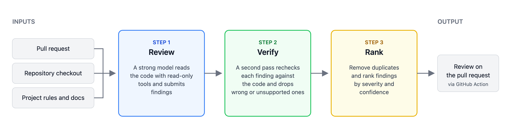

<h1 align="center">RevEngine</h1>

  

  A code reviewer you can run as a GitHub Action on your own pull requests.

  <a href="docs/INSTALL.md">Install</a> &nbsp;|&nbsp;
  <a href="https://github.com/laude-institute/headlong/pull/155#pullrequestreview-5529766020">Example review</a> &nbsp;|&nbsp;
  <a href="https://github.com/laude-institute/headlong/pull/150#pullrequestreview-5529787934">Another example</a>

This is still early work, and the prompts and settings may change.

## Use it

A person with write access starts a review by commenting `/review` on a pull request. The findings come back as one review, with comments on the changed lines and a short summary that opens with merge advice. With Claude Opus 5.5, a typical review takes about 3 minutes and costs about $1 in OpenRouter tokens. See [docs/INSTALL.md](docs/INSTALL.md) to set it up.

## How it reviews

<picture>
  <source media="(prefers-color-scheme: dark)" srcset=".github/revengine-diagram-dark.png">
  
</picture>

1. **Review.** A strong model reads the change with read-only tools. It is asked to understand the system before judging the change.
2. **Verify.** A second pass checks every proposed finding against the code, rejects the ones that do not hold, and marks repeats.
3. **Rank.** Duplicates are merged, and the remaining findings are ranked by severity and confidence.

## Safety

- The model only reads the pull request's code. It never runs the code, and the pull request's text is treated as untrusted input.
- The project's rules, such as `AGENTS.md` and `CONTRIBUTING.md`, are read from the base branch, so a pull request cannot rewrite the rules it is reviewed against.
- Only people with write access can start a review, and pull requests from forks are skipped unless you allow them.

## Docs

| Doc | What it covers |
|---|---|
| [Install](docs/INSTALL.md) | The workflow to add, and the Action's inputs. |
| [Settings](docs/SETTINGS.md) | Every setting the reviewer container reads. |
| [ReviewBench](docs/REVIEWBENCH.md) | How the reviewer runs in [ReviewBench](https://github.com/review-bench/ReviewBench), an open benchmark for AI code review, and how to run it locally. |
| [Evals](evals/README.md) | Our own checks of severity, merge advice and known false positives on pull requests a person has labeled. |

## License

Apache 2.0. See [LICENSE](LICENSE).
